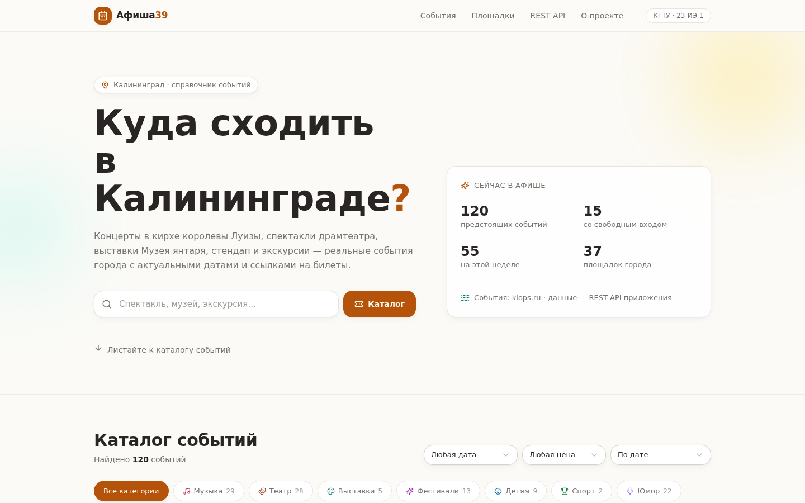

# Афиша39 — куда сходить в Калининграде

Веб-приложение — единый каталог досуговых событий Калининграда: концерты в филармонии,
спектакли драмтеатра, стендап, выставки, лекции и городские фестивали. Каталог наполняют
**реальные события**, которые ежедневно собирает краулер проекта с публичной серверной
афиши [klops.ru](https://klops.ru/afisha/), и обслуживается собственным REST API.

> Учебный проект по дисциплине **«Сетевые информационные технологии»**.
> КГТУ, институт цифровых технологий, группа 23-ИЭ-1, Волков Иван Николаевич, 2026.



## Возможности

- **Каталог реальных событий** — афиша Калининграда на горизонте до полугода:
  даты, площадки, возрастной ценз, описания и обложки из источника;
- **Фильтры и мгновенный поиск** — по категории, дате (сегодня / завтра / выходные /
  неделя / месяц), стоимости (бесплатно / платно) и сортировке (дата / цена);
- **Карточка события** — площадка и адрес, дата и время, возрастной ценз, описание
  и **кнопка «Купить билет»** со ссылкой на официального продавца;
- **Справочник площадок** — все места проведения с числом предстоящих событий
  и гео-координатами из микроформата schema.org;
- **Живая статистика** — счётчики каталога на главной странице (данные из `/api/stats`);
- **Встроенная документация REST API** — описание всех эндпоинтов с кнопкой «Выполнить»:
  запрос уходит из браузера пользователя, интерфейс показывает код состояния и тело ответа;
- **Адаптивная вёрстка** — от смартфона (390 px) до настольного монитора (1440 px);
- **Автообновление данных** — GitHub Actions каждый день запускает краулер и коммитит
  свежую афишу (Vercel после push переустанавливает приложение автоматически).

## Технологический стек

| Слой | Технологии |
| --- | --- |
| Клиент | React 19, Next.js 16 (App Router), TypeScript, Tailwind CSS 4, shadcn/ui, TanStack Query, Zustand |
| Сервер | Next.js Route Handlers — REST API из пяти эндпоинтов |
| Данные | Краулер на Node.js (HTTP + разбор HTML и schema.org/Event) → JSON-датасет в репозитории |
| Инфраструктура | Локальный запуск через Node.js 18+; облако — Vercel; расписания — GitHub Actions |

## Архитектура и REST API

Приложение построено по трёхслойной клиент-серверной схеме: SPA обращается к
собственному REST API по протоколу HTTP, API обслуживается движком запросов,
работающим с JSON-датасетом в памяти.

| Метод | Маршрут | Назначение | Параметры |
| --- | --- | --- | --- |
| GET | `/api/events` | Каталог событий | `category`, `venue`, `price`, `date`, `q`, `sort`, `limit`, `offset` |
| GET | `/api/events/[id]` | Карточка события | `id` — идентификатор |
| GET | `/api/venues` | Справочник площадок | — |
| GET | `/api/categories` | Справочник категорий | — |
| GET | `/api/stats` | Статистика каталога | — |

Примеры запросов:

```
GET /api/events?category=concerts&date=weekend&limit=10
GET /api/events?q=орган&price=free
GET /api/events?sort=price&limit=5
```

Ответы возвращаются в формате JSON с корректными кодами состояния
(200 / 400 / 404) и заголовком `Cache-Control: public, s-maxage=60, stale-while-revalidate=300`.

## Быстрый старт (локальный запуск)

Требуется **Node.js 18 или новее** ([nodejs.org](https://nodejs.org)).

```bash
# 1. Установить зависимости
npm install

# 2. Запустить в режиме разработки
npm run dev

# 3. Открыть в браузере
# http://localhost:3000
```

Продакшен-сборка и запуск:

```bash
npm run build
npm start
```

## Подсистема данных: сбор реальной афиши

Каталог наполняет **краулер `scripts/fetch-events.mjs`** — он собирает события с
публичной серверной афиши [klops.ru](https://klops.ru/afisha/) (региональное СМИ,
материалы распространяются по лицензии Creative Commons CC BY-SA 4.0):

1. **Обход списочных страниц** — главная афиша и поисковые страницы категорий
   (концерты, театр, стендап, выставки, фестивали, спорт, лекции, встречи,
   экскурсии) и подборка «Сходить с детьми»;
2. **Загрузка детальных страниц** событий с соблюдением регламента вежливости
   (паузы между запросами, ограничение параллелизма, повторные попытки);
3. **Разбор микроформата schema.org/Event** — точные даты и время сеансов,
   полные названия площадок, гео-координаты, возрастной ценз, кнопка продажи
   билетов, описание;
4. **Нормализация** — сопоставление категорий источника с категориями приложения,
   обогащение данных о площадках, развёртывание многосеансовых событий в отдельные
   карточки, отбрасывание прошедших дат;
5. **Сохранение** датасета `src/data/events.json`, который читает REST API.

Модель цены: `0` — свободный вход (в источнике помечен «Вход свободный»),
`-1` — вход платный, точная цена не публикуется (кнопка ведёт к продавцу билетов).

Защита от сбоев источника: если собрано аномально мало событий, краулер
**не перезаписывает** датасет и завершается с ошибкой — приложение продолжает
работать с последним успешным снимком афиши.

```bash
# Собрать свежую афишу вручную
npm run data:fetch
```

### Автообновление по расписанию

В репозиторий включён рабочий процесс `.github/workflows/update-events.yml`:
каждый день в 06:30 по Калининграду GitHub Actions запускает краулер и
коммитит обновлённый `src/data/events.json`, если афиша изменилась. После
push Vercel автоматически передеплоит приложение — данные всегда актуальны,
ручные действия не нужны.

> После первого пуша репозитория проверьте вкладку **Actions**: при первом
> запуске GitHub может попросить подтверждение запуска рабочих процессов.

### Демонстрационный генератор (резервный сценарий)

Репозиторий также содержит `scripts/generate-events.mjs` — генератор
демонстрационного датасета на основе типичной афиши реальных площадок города
(даты относительно текущего дня). Он полезен, если нужно показать приложение
без доступа к сети:

```bash
npm run data:generate   # перезапишет events.json демонстрационными данными
npm run data:fetch      # вернуть реальную афишу
```

## Публикация на GitHub

```bash
# в каталоге проекта
git init
git add .
git commit -m "Афиша39: первая версия проекта"
git branch -M main

# создайте пустой репозиторий на github.com, затем:
git remote add origin https://github.com/<ваш-логин>/afisha39.git
git push -u origin main
```

## Развёртывание на Vercel

1. Зайдите на [vercel.com](https://vercel.com) и войдите через аккаунт GitHub;
2. Нажмите **Add New → Project** и выберите репозиторий `afisha39`;
3. Vercel определит Next.js автоматически — нажмите **Deploy**;
4. Через минуту приложение будет доступно по адресу вида
   `https://afisha39-<подпись>-<команда>.vercel.app`.

Каждое новое изменение в ветке `main` будет разворачиваться автоматически —
включая ежедневные коммиты краулера с обновлённой афишей.
Подробнее — [vercel.com/docs/deployments](https://vercel.com/docs/deployments).

## Структура проекта

```
afisha39/
├── .github/workflows/update-events.yml  # ежедневное автообновление афиши
├── docs/                        # скриншоты приложения для README
├── public/                      # статические файлы
├── scripts/
│   ├── fetch-events.mjs         # краулер реальной афиши klops.ru
│   ├── generate-events.mjs      # демонстрационный генератор (резерв)
│   └── parse-example.mjs        # демонстрация HTTP-разбора HTML
└── src/
    ├── app/
    │   ├── api/                 # REST API (5 маршрутов)
    │   ├── layout.tsx           # корневой макет, шрифты, метаданные
    │   ├── page.tsx             # главная страница (SPA)
    │   └── globals.css          # тема «Янтарь и Балтика», анимации
    ├── components/
    │   ├── afisha/              # компоненты приложения
    │   └── ui/                  # библиотека shadcn/ui
    ├── data/events.json         # датасет реальных событий
    ├── hooks/                   # React-хуки (toast, адаптивность)
    └── lib/                     # движок запросов, типы, утилиты API
```

## Источник данных и права

События собираются с публичной серверной афиши [klops.ru](https://klops.ru/afisha/)
автоматическим обходом страниц с указанием ссылки на источник в каждом событии
(поле `sourceUrl`). Материалы сайта klops.ru распространяются по лицензии
[Creative Commons «Attribution-ShareAlike» 4.0](https://creativecommons.org/licenses/by-sa/4.0/deed.ru).
Приложение не продаёт билеты и не хранит персональные данные: кнопка «Купить
билет» ведёт на сайт официального продавца.
